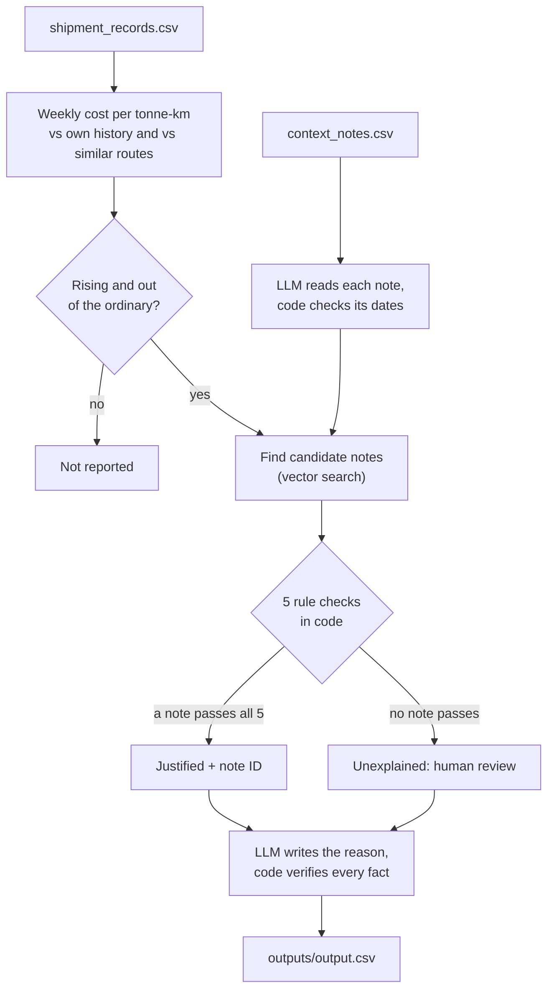

# Freight Cost Watch

An assistant that tracks what each freight route costs per tonne per km, week by week, and flags routes
whose cost is rising out of the ordinary. For every flag it checks the context notes for a real reason
(fuel prices, floods, festivals…) and explains the result in plain English. It either **cites the exact
note** that justifies the rise, or says clearly that **nothing explains it** and a human should look.

*Built for the FreightTiger Software Engineering Intern (AI) case study.*

## At a glance

| Area | Result |
|---|---|
| **Findings** | 20 route-weeks flagged: **3 justified** by a note, **17 unexplained** and sent for human review |
| **Accuracy** | 20/20 verdicts and cited notes match my hand-labelled answer key. **0 invented justifications** |
| **Repeatable** | 3 repeat runs, plus 5 runs with randomness turned up (temperature 0.8), give identical flags, numbers and verdicts: all share fingerprint `259570e2e17c` |
| **Cost** | 2 LLM calls and about 6,400 tokens per full run. **$0** on Groq's free tier (about $0.002 at list price) |
| **Models** | OpenAI **gpt-oss-120B** (open weights) on Groq for reading and writing; small local all-MiniLM embeddings for search |
| **Tests** | 76 automated tests, 96% code coverage. They run offline in about 2 seconds |

**Required deliverables:**
- [`outputs/output.csv`](outputs/output.csv): the results file.
- [`outputs/repro_report.md`](outputs/repro_report.md): the 3-run reproducibility check.
- [`outputs/token_log.json`](outputs/token_log.json): the token and cost log.
- This README.

## What it found

| Route | Week(s) | Verdict | Why |
|---|---|---|---|
| Ahmedabad-Mumbai | 2025-01-20 | ✅ Justified: **N002** | Festival-week surcharge on this corridor, that exact week |
| Chennai-Bangalore | 2025-02-24, 03-03 | ✅ Justified: **N001** | Flooding on this highway from Feb 24 to Mar 8 |
| Chennai-Bangalore | 2025-03-10, 03-17 | ⚠️ Unexplained | Costs stayed +14-22% *after* the flood ended. N009 only says the road reopened |
| Delhi-Jaipur | 2024-11-11, 11-18 | ⚠️ Unexplained | A +28-36% spike; the only Delhi-Jaipur note (N007, May 2024) is about road *improvement* |
| Mumbai-Delhi | 2025-05-12 | ⚠️ Unexplained | The diesel note N003 applies, but explains about 5-7%, not the +11.6% seen |
| Mumbai-Pune | 2025-06-23 | ⚠️ Unexplained | +20.6% above similar routes. Diesel rose for *every* route, so it can't explain a gap between routes |
| Mumbai-Pune | 11 weeks, 2025-09-15 to 12-22 | ⚠️ Unexplained | **A slow creep:** now +23% above its pre-September level and +20-39% above similar routes |

> **The Mumbai-Pune creep is the brief's "cost quietly creeping up" case.** Each week is only 3-9% above
> the route's own recent average, because that average creeps up with it. Comparing the route with
> similar routes catches it, and each reason states how long the rise has lasted.

## How it works



1. **Measure.** Cost per tonne-km for every route and week (Monday to Sunday). Each week is compared with
   (a) the same route's previous 8 weeks and (b) other routes of the same length (Short / Medium / Long)
   that week.
2. **Flag.** A week is flagged if it is ≥10% above its own history, or rising and ≥20% above similar routes.
3. **Retrieve.** The 10 notes are embedded in a FAISS vector index. Each flag searches the notes for its
   route and week.
4. **Decide, in code.** A note justifies a flag only if it passes all 5 checks:
   - right route;
   - it reports a cost *increase*;
   - its dates cover that week;
   - an all-routes note can't explain a gap between routes;
   - the size of the rise fits what the note says.
5. **Explain.** The LLM writes each reason in plain English. Code adds the verdict and note ID, and
   rejects any reason that mentions a note, number, date or route that isn't in the facts.

**The core design choice: AI reads and writes; code decides.** The LLM never picks a verdict or a
note. That is why results are repeatable and a justification can't be made up.

## How each requirement is met

| Brief requirement | How it is met | Evidence |
|---|---|---|
| Group by route and `route_type` | Route = origin-destination; `route_type` used as given | `assistant/metrics.py` |
| Weekly cost per tonne-km | Week's total cost ÷ total (tonnes × km); weeks start on Monday | All 3 sample rows reproduced to the decimal (test) |
| **vs own history** | Average of the 8 weeks *strictly before* the week; no look-ahead | Look-ahead test; independent recomputation |
| ↳ fewer than 8 prior weeks | **All available prior weeks are used.** This affects only the first 8 weeks of data (2024-01-01 to 2024-02-19). The count is in `history_weeks_used`. Nothing is padded or extrapolated | `outputs/weekly_metrics.csv` |
| **vs similar routes** | Average of the *other* routes with the same `route_type`, same week | Test; independent recomputation |
| Flag rising, unusual costs | ≥ +10% vs own history, or rising and ≥ +20% vs similar routes | `outputs/weekly_metrics.csv` |
| Check notes first (RAG) | FAISS vector index + 5 rule checks | [`outputs/decisions.json`](outputs/decisions.json) |
| Plain-English, grounded reasons | LLM writes; code verifies each fact against the notes | `reason` column; 20/20 verified |
| *Stretch:* answer questions | `python -m assistant ask "…"`, answered only from the results | See *Run it* |
| No hallucination | Verdicts from code; "justified" only with a matching note; otherwise "unexplained" | [`outputs/eval_report.md`](outputs/eval_report.md): 0 invented |
| Knowing it's right | Eval harness against hand-labelled answers + 20 trick notes | [`outputs/eval_report.md`](outputs/eval_report.md) |
| Reproducibility | 3 cold runs; 5 runs at temperature 0.8 | [`repro_report.md`](outputs/repro_report.md), [`stress_report.md`](outputs/stress_report.md) |
| Cost of running | Calls, input/output tokens, cost logged per run | [`outputs/token_log.json`](outputs/token_log.json) |
| Exact output format | Same columns, order and number formats as the sample | Test against the sample file |

## Why the results can be trusted

- **The LLM cannot invent a justification.** A row is "justified" only if a note passes all 5 code
  checks. The decoy notes are all correctly rejected:
  - N004: toll on routes outside this dataset.
  - N005: "costs were not significantly affected".
  - N006 and N008: stable demand, normal movement.
  - N007 and N009: road improved, route back to normal.
  - N010: "no rate change".
- **It matches an answer key.** The verdict and cited note are right for 20/20 flagged weeks, and I
  labelled them independently by reading the notes.
- **It survives trick notes.** I wrote 20 notes designed to fool it: forecasts, withdrawn surcharges,
  missing end dates, unrelated percentages. **0 unsafe misreads**, and 11/11 on the 11 that were written in
  advance and never tuned against.
- **It repeats.** Every repeat run produces the same fingerprint of flags, numbers, verdicts and notes,
  including at temperature 0.8.
- **The arithmetic is double-checked.** A separate, from-scratch implementation recomputes all 728
  route-weeks and agrees exactly. 76 tests in total.

## Run it

```bash
pip install -r requirements.txt
ollama pull all-minilm              # small local embedding model (Ollama must be running)
export GROQ_API_KEY=your_key        # free at console.groq.com. Windows: set GROQ_API_KEY=your_key
                                    # (or save the key in a file named "groq api key.txt" in this folder)
python -m assistant run             # about 1 minute; writes everything in outputs/
```

| Command | What it does | LLM calls |
|---|---|---|
| `python -m assistant run` | Full analysis → `outputs/` | 2 |
| `python -m assistant eval` | Scores the run against the answer keys | 1 |
| `python -m assistant repro` | 3 cold runs, compared | 6 |
| `python -m assistant stress` | 5 runs at temperature 0.8, compared with the shipped output | 10 |
| `python -m assistant ask "Why did Chennai-Bangalore get pricier in March?"` | Answers from the results only | 0-1 |
| `python -m pytest tests` | 76 tests, offline | 0 |

Options:
- `--shipments`, `--notes`, `--out`: use other input files.
- `--cache`: makes reruns byte-identical.
- `-q`: quiet.

## Key decisions and trade-offs

- **Thresholds (10% / 20%).**
  - Only about 1% of route-weeks are more than +11% above their own history, so +10% is genuinely unusual.
  - The peer threshold is wider because some routes are normally pricier than their peers (Mumbai-Pune
    runs about 9% above Delhi-Jaipur).
  - Both are named constants.
- **When in doubt, a human decides.** Mumbai-Delhi's +11.6% is well beyond the 5-7% the diesel note
  explains, so it is marked unexplained instead of being stretched to fit.
- **Notes with no end date** (e.g. "diesel rose starting this week") count for 8 weeks. After that, the
  route's own 8-week average already includes the new price.
- **Route direction is ignored** for notes: a flood on the Bangalore-Chennai highway also affects
  Chennai-Bangalore trucks.
- **`output.csv` lists only flagged weeks,** like the sample. All 728 route-weeks are in
  `weekly_metrics.csv`.
- **The sample file's 3rd row isn't valid CSV** (unquoted commas). Our output quotes text properly;
  columns and formats are identical.
- **Model choice.** gpt-oss-120B on Groq. OpenRouter's Nemotron 120B and a local Llama 3.2 3B gave the
  same verdicts, but Groq was the fastest and has the largest free quota.
- **Embeddings run locally** because Groq has no embeddings API. all-MiniLM is a small search model, not
  an LLM.
- **The API key** is never stored in the code or the repo.

## Repository layout

```
assistant/        the code: about 1,100 lines in 10 small modules (see below)
data/             the three input files, exactly as provided
eval/             hand-labelled answer keys + 20 trick notes for testing
outputs/          results and evidence, regenerated by the commands above
tests/            76 offline tests
requirements.txt  pinned Python dependencies
```

| Output file | What it contains |
|---|---|
| [`output.csv`](outputs/output.csv) | **The deliverable**: one row per flagged week, in the sample's format |
| [`summary.md`](outputs/summary.md) | The 20 flags grouped into 6 episodes, one line each |
| [`weekly_metrics.csv`](outputs/weekly_metrics.csv) | All 728 route-weeks with both comparisons, history weeks used, and flags |
| [`decisions.json`](outputs/decisions.json) | For each flag: every note considered, its similarity, and the check it failed |
| [`notes_extracted.json`](outputs/notes_extracted.json) | How the LLM read each note, and the dates code accepted |
| [`token_log.json`](outputs/token_log.json) | LLM calls, tokens, cost, and exact model versions |
| [`eval_report.md`](outputs/eval_report.md), [`repro_report.md`](outputs/repro_report.md), [`stress_report.md`](outputs/stress_report.md) | The three checks |

| Code module | Responsibility |
|---|---|
| `metrics.py` | Weekly cost per tonne-km, both comparisons, flag rule, episodes |
| `notes.py` | LLM note reading with code checks on its dates; route matching; vector search |
| `verdict.py` | The 5 rule checks: justified or unexplained (no LLM) |
| `explain.py` | Reasons: one batched LLM call, fact checker, fallback template |
| `qa.py` | Question answering over the results |
| `llm.py` | Groq client: retries, token counting, optional cache |
| `pipeline.py`, `checks.py`, `__main__.py` | Orchestration, the three checks, command line |

## Technical details

<details>
<summary><b>Metric definitions</b></summary>

- **Cost per tonne-km** is a ratio of sums: the week's total freight cost ÷ the week's total (tonnes × km).
  This reproduces the sample rows exactly; a mean of per-shipment ratios is 0.01-0.3 points off.
- **vs own history** is the mean over the calendar window `[week − 8 weeks, week)`. A route's first week
  has no history and is never flagged. Every route has all 104 weeks, so from week 9 the full 8 weeks
  are always used.
- **vs similar routes** is the plain mean of the other routes with the same `route_type` that week. Short
  and Long have two routes each, so their comparison is a single route.
- **Rounding:** flags are decided on the same 1-decimal percentages the output prints.
- **Episodes:** flagged weeks on a route at most 4 weeks apart form one episode. That gives the
  "sustained rise" line in each reason.
- **Alternative I tested and rejected:** comparing a route's premium over its peers with its own recent
  premium. It misses the entire Mumbai-Pune creep, the same blind spot as the 8-week average.
</details>

<details>
<summary><b>The 5 rule checks (<code>verdict.py</code>)</b></summary>

1. **Route:** the note covers this route, or all routes. Matching ignores case, spacing and direction,
   and accepts lists.
2. **Direction:** the note reports a cost *increase*. "Not affected", "no rate change", "back to normal"
   and forecasts are not increases.
3. **Time:** the note's dates overlap the flagged week. N001 ends Mar 8, so the week of Mar 3 counts and
   Mar 10 doesn't.
4. **Scope:** an all-routes note (diesel) cannot explain why one route is pricier than similar routes.
5. **Size:** the rise may exceed the note's stated percentage by at most 3 points.

**Outcome:**
- The first note that passes all 5, in order of similarity, is cited.
- If none passes, the reason names the closest note (the one that passed the most checks) and which
  check it failed.
- Every route-relevant note is checked, so ranking can never hide the right one.
</details>

<details>
<summary><b>How the LLM is kept honest</b></summary>

**Reading notes** (1 call, strict JSON schema). The LLM labels each note's effect and duration. Code then
checks everything a verdict depends on:
- **Dates:** any date used must be *written in the note* ("Mar 8", "8th March", "Sep 9-10"). The order
  of trust is: a stated date range, then a stated number of weeks, then the LLM's label. Invented end
  dates are dropped.
- **Forecasts:** forward-looking wording ("expect", "proposed", "next quarter") can never count as a rise.
- **Percentages:** read by a regular expression, only from sentences about cost. "70% of fleets" is
  ignored.
- **Bad replies:** a malformed or missing reading means that note cannot justify anything.

**Writing reasons** (1 call for all 20).
- **Code writes the exact parts:** "Justified by note N001 (2025-02-24): …", "Unexplained: …", and the
  sustained-rise line.
- **The LLM writes only the sentence in between,** checked against *that row's* facts.
- **What gets rejected:**
  - any note ID, percentage, date or route not in the facts;
  - wording that contradicts the verdict;
  - empty or overlong text.
- **Unusual hyphens:** text is normalised to plain hyphens first. gpt-oss writes dates with non-breaking
  hyphens that would otherwise slip past the date check.
- **Fallback:** a rejected reason is replaced by a template. In the shipped run, 20/20 reasons passed.

**Questions.**
- "Why" questions get one LLM call, answering only from the matching results, with the same fact check.
- "Which / how many" questions are counted by code, with no LLM call.
- Unknown routes are refused without an LLM call.
</details>

<details>
<summary><b>Evaluation sets (<code>eval/</code>)</b></summary>

- **`gold_notes.json`:** how each of the 10 notes should be read (raises cost? which weeks?), with a reason
  for each.
- **`gold_verdicts.csv`:** the correct verdict and note for all 20 flagged weeks, with a one-line rationale.
- **`adversarial_notes.csv`:** 20 trick notes:
  - **Probe set (9):** these exposed three bugs early on (a forecast read as a rise, an invented end date,
    an off-by-one duration). The fixes were made in code.
  - **Held-out set (11):** written in advance and never tuned against. A15 and A16 moved to the probe set
    once I adjusted code or prompts with them in mind.
  - **Scoring:** misreads are split into *unsafe* (could create a false justification) and
    *conservative* (can only produce "unexplained"). Unsafe must be zero.
</details>

<details>
<summary><b>Problems the checks caught (all fixed, each now covered by a test)</b></summary>

- **Label overruled the dates.** At temperature 0.8 the LLM once labelled the flood note "one week" even
  though it had read the dates correctly. Dates written in a note now outrank the label.
- **Schema rejection.** Groq's strict JSON mode rejected one reply because a field had no valid value for
  "no change" notes. A `not_applicable` value was added, and such rejections are retried.
- **Hyphen loophole.** Non-breaking hyphens let dates bypass the fact check (see above).
- **Misleading end date.** A policy end date (the 8-week rule) was being phrased as if the note said it.
  The LLM no longer sees that date.
</details>

<details>
<summary><b>Reproducibility in detail</b></summary>

- **Shipped settings:** temperature 0, seed 42, low reasoning effort.
- **Cold runs:** `repro` and `stress` start from scratch in a temporary folder each time, and keep only
  their report.
- **Fingerprint:** each report lists a fingerprint (SHA-256) of every run's flags, numbers, verdicts and
  notes. Identical fingerprints mean identical results.
- **Wording:** a hosted model's wording can still vary slightly at temperature 0, which the brief allows.
  `--cache` replays saved LLM replies to make reruns byte-identical; it is off for the checks, so they
  genuinely re-ask the model.
- **Model versions:** `token_log.json` records Groq's `system_fingerprint` and the embedding model's
  version.
</details>
